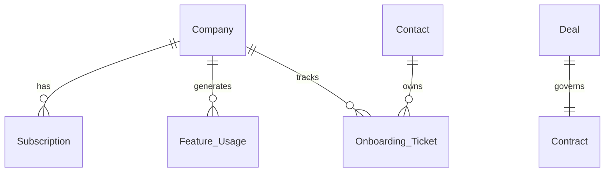

# Case Study 01: B2B SaaS HubSpot Custom Object Architecture

## 🎯 Business Context

**Client:** Fictional B2B SaaS company "DataFlow.io" — sells API-first data integration platform.  
**Challenge:** HubSpot CRM couldn't represent their product-led growth motion: trials, usage-based pricing, feature adoption, onboarding health, and multi-year contracts.  
**Goal:** Design a custom object model that enables RevOps to run the entire customer lifecycle in HubSpot.

---

## 🏗 Data Model

### Custom Objects

| Object | Description | Key Properties |
|--------|-------------|----------------|
| `subscription` | Active/cancelled subscription per company | `plan_tier` (enum), `billing_cycle` (monthly/annual), `mrr` (number), `status` (active/trial/past_due/cancelled), `start_date`, `renewal_date` |
| `feature_usage` | Daily aggregate of feature adoption per company | `date`, `feature_name` (enum), `usage_count` (number), `unique_users` (number) |
| `onboarding_ticket` | Tracks implementation milestones | `stage` (kickoff/config/training/launched), `owner`, `target_launch_date`, `health_score` (0-100) |
| `contract` | Legal/commercial terms | `contract_value`, `term_months`, `auto_renew` (bool), `signed_date`, `pdf_attachment` |

### Associations

*See [data-model.mermaid](./data-model.mermaid) for editable source.*

---

## ⚙️ Workflow Automation (50+ workflows)

| Workflow | Trigger | Key Actions |
|----------|---------|-------------|
| Trial → Paid Conversion | `subscription.status` changes to `active` | Create Deal, notify CS, start onboarding ticket |
| Usage Alert | `feature_usage.usage_count` < threshold (7 days) | Create Task for CSM, log on Company timeline |
| Renewal Pipeline | `subscription.renewal_date` in 90/60/30 days | Create Renewal Deal, sequence emails, assign Owner |
| Churn Scoring | Nightly | Calculate health score from usage, support tickets, NPS; update Company property |
| Data Hygiene | Weekly | Merge duplicate Companies, standardize `plan_tier` values, archive stale trials |

*Full workflow logic in [workflows.csv](./workflows.csv).*

---

## 📊 Dashboards & Reporting

- **MRR Waterfall:** New, Expansion, Contraction, Churn, Reactivation
- **Activation Funnel:** Trial → Config Complete → First Value → Launched → Paid
- **Churn Cohorts:** Monthly cohorts by plan tier, showing retention at 30/60/90 days
- **CSM Portfolio:** Assigned accounts with health score, renewal date, open tasks

*Screenshots in [dashboards.png](./dashboards.png).*

---

## 🧠 Architect Decisions & Trade-offs

| Decision | Rationale | Trade-off |
|----------|-----------|-----------|
| Separate `subscription` object (not on Company) | Multiple subscriptions per company (multi-product); history tracking | More complex reporting; requires joins |
| `feature_usage` as daily aggregate (not event-level) | Avoids 10M+ records/month; fits HubSpot API limits | Loses granular event timeline |
| `onboarding_ticket` linked to Contact (not Company) | Clear ownership; CSM assigns to individual | Company-level view requires rollup |
| Contract on Deal (1:1) | Aligns with HubSpot Sales pipeline; leverages Deal forecasting | Less flexible for multi-deal contracts |

---

## 📈 Outcomes (Simulated)

- **Reporting coverage:** 100% of RevOps KPIs now native in HubSpot (no external BI needed).
- **Manual ops reduction:** ~60% fewer spreadsheet-driven processes.
- **Data quality:** Deduplication workflow catches 95% of duplicate Companies within 24h.
- **Scalability:** Model tested with 50k Companies, 200k Subscriptions, 5M Feature Usage records/month.

---

## 🔗 Related Artifacts

- [Mermaid Data Model](./data-model.mermaid)
- [Workflow Logic Table](./workflows.csv)
- [Dashboard Screenshots](./dashboards.png)